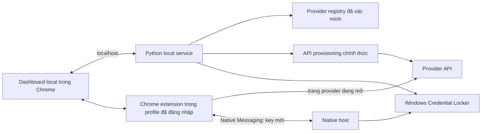

# Đặc tả thiết kế: Dashboard provider miễn phí và tạo API key

**Trạng thái:** Bản nháp để người dùng duyệt
**Ngày:** 2026-10-23
**Repo:** `FreeModel_Lab`

## 1. Mục tiêu

Tạo một giao diện local dễ dùng để người dùng:

- Xem **chỉ các provider có quota miễn phí duy trì**.
- Kiểm tra thông tin model, endpoint, giới hạn free tier, yêu cầu tài khoản/thẻ thanh toán, trạng thái kết nối, nguồn và ngày xác minh.
- Tạo và lưu API key tự động ở mức provider cho phép, ưu tiên API provisioning chính thức; dùng Chrome đã đăng nhập cho các luồng dashboard còn lại.
- Quản lý key cục bộ qua Windows Credential Locker, không hiển thị hoặc ghi key vào log.

Dashboard thay thế việc tra cứu rời rạc trong CLI, đồng thời giữ các lệnh CLI hiện có làm đường dự phòng và tương thích.

## 2. Định nghĩa và quy tắc đưa provider vào danh sách

- **Free** nghĩa là provider hiện công bố một mức sử dụng API miễn phí tiếp tục sau giai đoạn dùng thử. Provider chỉ cấp trial hoặc credit khuyến mại một lần không được đưa vào danh sách hoạt động.
- Provider có free tier nhưng yêu cầu thẻ thanh toán vẫn có thể được liệt kê; giao diện phải ghi rõ yêu cầu đó.
- `awesome-free-llm-apis/data.json` chỉ là nguồn khám phá provider. Một mục chỉ vào danh sách hoạt động khi có nguồn chính thức của provider xác nhận free tier.
- Mỗi mục phải có nguồn chính thức cho free tier và giới hạn, cùng ngày xác minh gần nhất. Thông tin được xác minh trong vòng 30 ngày mới xuất hiện trong danh sách free đang hoạt động; mục quá hạn hoặc chưa đủ rõ được ẩn cho đến khi xác minh lại.
- Không suy diễn quota còn lại từ số liệu giá hoặc mức dùng miễn phí chung. Nếu provider không có API usage/quota chính thức, hiển thị giới hạn công bố và ghi “không có quota live”.

## 3. Trải nghiệm người dùng

Dashboard local mở trong Chrome profile người dùng đang sử dụng. Màn hình chính hiển thị danh sách provider miễn phí dưới dạng bảng hoặc thẻ:

| Trường | Nội dung |
| --- | --- |
| Provider / model | Tên provider và model nằm trong free tier |
| Giới hạn | RPM, RPD, TPM, token/ngày/tháng hoặc giới hạn khác theo tài liệu chính thức |
| Điều kiện | Cần tài khoản, thẻ thanh toán, khu vực, hoặc key hay không |
| Endpoint | Endpoint chính thức, nếu provider công bố |
| Key | Chưa có, đã lưu, tạo bằng API, tạo qua Chrome, hoặc hướng dẫn thủ công |
| Kiểm tra | Kết quả kết nối gần nhất và thời gian kiểm tra |
| Nguồn | Liên kết tới tài liệu chính thức và ngày xác minh |

Các thao tác riêng:

- **Làm mới danh mục:** đồng bộ danh sách khám phá upstream; không tự coi mục upstream là miễn phí đã xác minh.
- **Mở nguồn giới hạn:** mở trang tài liệu chính thức.
- **Tạo key:** bắt đầu luồng cho đúng provider. Việc tạo chỉ khởi động khi người dùng bấm nút này.
- **Kiểm tra kết nối:** nếu có key, gửi một yêu cầu tối thiểu theo API chính thức sau khi người dùng bấm; không polling nền. Kết quả phân biệt được kết nối, lỗi xác thực, rate limit, quota hết và lỗi mạng khi provider cho phép nhận biết.
- Nếu không có key hoặc API usage chính thức, giao diện ghi rõ điều đó thay vì hiển thị trạng thái live giả định.

## 4. Kiến trúc

### 4.1 Các thành phần

1. **Python local service:** cung cấp dashboard và API cục bộ, bind riêng `127.0.0.1`; tái sử dụng catalog, adapter provisioning và Windows Credential Locker hiện có.
2. **Local dashboard:** HTML/CSS/JavaScript phục vụ từ Python và mở trong Chrome hiện có. Đây là giao diện web local, không phải WebView nhúng có profile đăng nhập riêng.
3. **Chrome extension:** cài trong đúng Chrome profile người dùng đã đăng nhập; chỉ xin quyền host tùy chọn trên domain chính thức đang xử lý. Extension thao tác trên trang nhìn thấy được của provider.
4. **Native Messaging host:** cầu nối local giữa extension và Python để lưu key mới vào Windows Credential Locker. Extension chỉ chuyển key mới khi provider vừa tạo; không chuyển cookie hay session.
5. **Provider registry:** metadata đã xác minh, gồm free tier, model, endpoint, giới hạn, yêu cầu thanh toán, URL nguồn, ngày xác minh và khả năng tạo key.
6. **Provisioning adapters:** adapter API chính thức hiện có được giữ làm ưu tiên. Provider chưa có adapter chính thức dùng Chrome flow khi có thể xác định trang và thao tác an toàn; trường hợp còn lại dùng hướng dẫn và `save-key`.

### 4.2 Tạo và lưu key

- Dùng adapter API chính thức hiện có khi provider hỗ trợ, ví dụ Google Gemini, Cloudflare Workers AI và OpenRouter. Quyền/token bootstrap cần thiết được thể hiện rõ; Cloudflare và OpenRouter vẫn cần bootstrap key do người dùng chủ động cấp theo luồng hiện tại.
- Với provider chỉ tạo key qua dashboard, extension mở đúng domain chính thức, điền form và thực hiện thao tác tạo trong phiên đã đăng nhập. Key mới chỉ được đọc từ kết quả hiển thị của trang vừa tạo key và chuyển thẳng qua Native Messaging để lưu.
- Nếu trang đổi, selector không còn khớp, hoặc kết quả không xác định, extension dừng và chuyển sang hướng dẫn thủ công. Không bấm nút thay thế theo suy đoán.
- Provider không cần key cho free path vẫn có thể xuất hiện trong danh sách và được đánh dấu “không cần key”.
- Việc ghi đè key yêu cầu xác nhận riêng; UI không giả định key cũ đã được revoke.

## 5. Ranh giới bảo mật và tự động hóa

- Không đọc cookie, localStorage/sessionStorage, database profile, clipboard, hay file cấu hình đăng nhập Chrome.
- Không dùng Chrome remote debugging/CDP để điều khiển profile mặc định.
- Extension không dùng quyền `cookies` hoặc `debugger`; quyền host chỉ cấp theo domain chính thức khi người dùng yêu cầu luồng provider đó.
- Không tự tạo tài khoản, nhập/lưu mật khẩu, lấy OTP, vượt MFA/CAPTCHA, tự chấp nhận điều khoản hoặc thanh toán.
- Khi provider yêu cầu MFA/CAPTCHA hoặc xác nhận nhạy cảm, extension tạm dừng để người dùng thao tác trong Chrome.
- Không xoay tài khoản/key để né quota, không tự gọi liên tục, không tuyên bố free tier là không giới hạn.
- Key không đi vào database dashboard, browser storage, log, telemetry, exception message hoặc giao diện sau khi lưu. Chỉ trạng thái “đã lưu” được hiển thị.
- Local service chỉ bind loopback, xác thực Origin/CSRF và không bật CORS rộng; extension/native host xác thực nguồn gọi và giới hạn message theo schema hẹp. Native host chỉ cho phép extension ID đã cài trong manifest của Chrome.

## 6. Lỗi và trạng thái không chắc chắn

- Upstream không truy cập được: giữ metadata đã có, đánh dấu lần đồng bộ thất bại và không nâng provider mới thành free đã xác minh.
- Nguồn chính thức không còn xác nhận ongoing free tier: bỏ mục khỏi danh sách hoạt động cho đến khi xác minh lại.
- Provider không công bố quota live: hiển thị quota tài liệu cùng ngày kiểm tra; không thay bằng số ước tính.
- API key sai/hết hạn: chỉ hiện mã lỗi và hướng xử lý an toàn; không in key vào output.
- Provider trả `429`: hiển thị rate limit/quota response và thời gian retry nếu response chính thức cung cấp; không retry tự động.
- Native Messaging hoặc Credential Locker lỗi: giữ key trong bộ nhớ tối thiểu có thể, không ghi ra file; báo lỗi và hướng người dùng thu hồi key nếu không thể xác nhận việc lưu.
- Lỗi UI/selector: dừng luồng, không thao tác tiếp, cung cấp link dashboard và hướng dẫn thủ công.

## 7. Phạm vi bản đầu

Bao gồm:

- Dashboard local cho danh sách provider free đã xác minh, giới hạn, nguồn, endpoint, tình trạng key và kiểm tra kết nối theo thao tác người dùng.
- Registry metadata có nguồn chính thức và ngày xác minh.
- Tái sử dụng các adapter API provisioning và Windows Credential Locker hiện có.
- Extension/Native Messaging cho các luồng dashboard provider được xác minh từng provider; có fallback thủ công.
- Giữ nguyên CLI `guide`, `provision`, `save-key` và khả năng hiện có.

Không bao gồm:

- Tự đăng ký tài khoản provider hoặc tự xử lý MFA/CAPTCHA/điều khoản/thanh toán.
- Tự động quét và diễn giải mọi trang tài liệu để quyết định free status mà không có review.
- Theo dõi quota liên tục trong nền, quota prediction, account rotation hoặc quota evasion.
- Tạo một browser profile riêng thay cho Chrome người dùng đã chọn.

## 8. Tiêu chí chấp nhận

1. Danh sách hoạt động chỉ hiện provider có nguồn chính thức hiện xác nhận ongoing free tier; trial-only, paid-only và trạng thái chưa xác minh không được liệt kê như free.
2. Mỗi provider hiển thị nguồn, ngày xác minh, free model, giới hạn đã công bố và điều kiện thẻ/tài khoản khi có dữ liệu.
3. UI phân biệt metadata quota với kết quả kết nối và không tuyên bố quota còn lại nếu không có API chính thức.
4. Kiểm tra API chỉ chạy khi người dùng bấm, dùng yêu cầu tối thiểu và không tự retry.
5. Lệnh tạo key chỉ thao tác trên API chính thức hoặc domain provider được cho phép; MFA/CAPTCHA/xác nhận nhạy cảm trả quyền điều khiển cho người dùng.
6. Key mới được lưu trong Windows Credential Locker và không xuất hiện trong dashboard, browser storage, log hay file catalog.
7. UI/flow không phù hợp sẽ dừng an toàn và cung cấp fallback hướng dẫn thủ công.
8. Các lệnh CLI hiện tại tiếp tục hoạt động.

## 9. Nguồn và căn cứ ban đầu

- [Danh sách provider upstream](https://github.com/mnfst/awesome-free-llm-apis/blob/main/data.json) — nguồn khám phá, không phải căn cứ duy nhất để xác nhận free tier.
- [Chrome host permissions](https://developer.chrome.com/docs/extensions/reference/api/permissions), [Chrome Native Messaging](https://developer.chrome.com/docs/extensions/develop/concepts/native-messaging), [thay đổi remote debugging từ Chrome 136](https://developer.chrome.com/blog/remote-debugging-port?hl=en).
- [Google API Keys create](https://docs.cloud.google.com/api-keys/docs/reference/rest/v2/projects.locations.keys/create), [Cloudflare tạo token qua API](https://developers.cloudflare.com/fundamentals/api/how-to/create-via-api/), [OpenRouter tạo key](https://openrouter.ai/docs/api/api-reference/api-keys/create-a-new-api-key).
- Mã hiện tại trong `provider_helper.py`, `README.md`, `AI_GUIDE.md` và `requirements.txt` là căn cứ cho tương thích và hành vi cần giữ.
